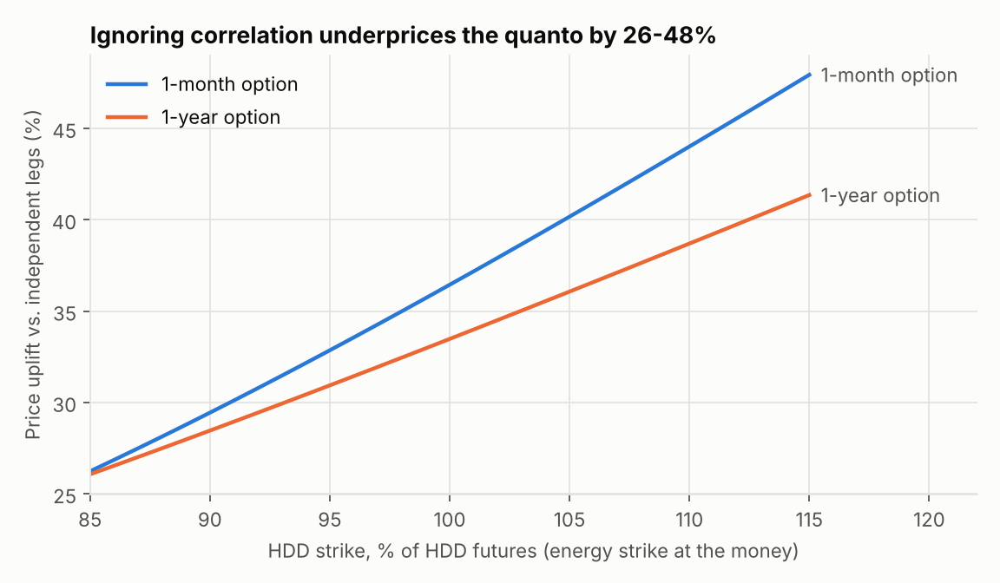
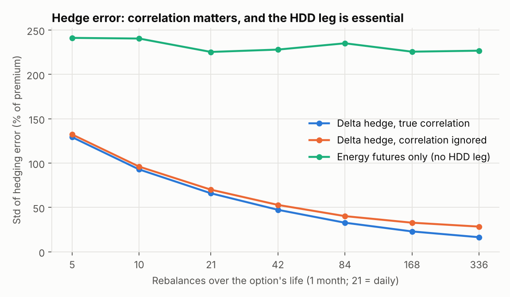

# Quanto options in energy markets

[](https://github.com/haelassri/quanto-energy-options/actions/workflows/tests.yml)

Pricing and hedging of **energy-temperature quanto options**: contracts whose payoff is the product of an energy-price leg and a weather leg, e.g.

$$
\text{payoff} = \big(F_E(T) - K_E\big)^+ \times \big(F_I(T) - K_I\big)^+ ,
$$

where $F_E$ is an energy futures price and $F_I$ a heating-degree-day (HDD) futures index. A utility that must buy power when it is both cold and expensive can hedge that **joint** risk with one contract. Neither a power option nor a weather option alone can do that.

The pricing framework follows [Benth, Lange & Myklebust (2015), *Pricing and hedging quanto options in energy markets*, Journal of Energy Markets 8(1)](https://research.cbs.dk/en/publications/pricing-and-hedging-quanto-options-in-energy-markets-2/).

## Results

**1. Correlation is worth 26–48% of the price.** With the energy–HDD factor correlations estimated by Benth, Lange & Myklebust for New York ($\rho_W = 0.28$, $\rho_B = 0.18$), pricing the two legs as independent underprices an at-the-money-energy quanto by 26–48%. The gap grows with the HDD strike and is larger for short-dated options.



| Maturity | $\rho_{XY}$ | HDD strike 85% | ATM | HDD strike 115% |
|---|---|---|---|---|
| 1 month | 0.188 | +26.2% | +36.4% | +47.9% |
| 1 year | 0.158 | +26.1% | +33.5% | +41.4% |

**2. Hedging needs both futures and the right correlation.** A writer of a 1-month ATM quanto delta-hedges with energy and HDD futures (10,000 simulated paths). With the true correlation, the hedging error falls as $1/\sqrt{n}$ with the number of rebalances $n$. If correlation is ignored, the error stalls at a floor. If the hedge uses only energy futures, as when HDD futures are too illiquid to trade, the error stays above 200% of the premium.



| Rebalances | Correlated | Correlation ignored | Energy futures only |
|---|---|---|---|
| 21 (daily) | 66.0% | 70.1% | 225.4% |
| 84 | 32.8% | 40.3% | 235.2% |
| 336 | 16.5% | 28.5% | 226.8% |

*Standard deviation of terminal hedging error, % of premium.* Cross-correlations come from BLM (2015). The volatility levels in [`params.py`](src/quanto_energy/params.py) are illustrative: they match the shapes BLM describe but are not their estimates, so read the numbers as a mechanism, not a market quote.

## What is implemented

| Module | Contents |
|---|---|
| [`pricing.py`](src/quanto_energy/pricing.py) | Closed-form price for all four call/put combinations; analytic deltas and cross-gamma; BLM's two-sided "tailored" contract; Black-76 benchmark; Monte Carlo pricer with antithetic variates |
| [`volatility.py`](src/quanto_energy/volatility.py) | BLM two-factor futures model (long-term + Samuelson short-term factor), closed-form log-return variances and cross-covariance, correlation-matrix validation |
| [`bivariate.py`](src/quanto_energy/bivariate.py) | Vectorised bivariate normal CDF via Owen's T, accurate to 1e-12 and much faster than `scipy.stats.multivariate_normal` |
| [`hedging.py`](src/quanto_energy/hedging.py) | Exact simulation of correlated futures paths; discrete delta hedging with tailed futures positions; three hedging strategies |
| [`models.py`](src/quanto_energy/models.py) | Seasonal + Ornstein–Uhlenbeck (AR(1)) spot models for temperature and power; HDD/CDD indices; residual and month-by-month correlation |
| [`autocallable.py`](src/quanto_energy/autocallable.py) | Monte Carlo pricer for (worst-of) autocallable notes: step-down autocall, coupon barrier with memory, knock-in put monitored at maturity, on observation dates or daily; quanto drift adjustment; seasoned notes; bump-and-reprice delta and vega |
| [`data.py`](src/quanto_energy/data.py) | Loaders for Open-Meteo temperature (no key), ENTSO-E day-ahead prices (free key) and CSV files, with local caching |

The closed form is derived step by step in [`docs/derivation.md`](docs/derivation.md). The derivation is independent of the paper and is cross-checked by the tests.

## Validation

`pytest` runs 56 tests:

- The closed form matches Monte Carlo within 4 standard errors for every call/put combination and correlation.
- At $\rho = 0$, the price reduces exactly to the product of two Black-76 prices.
- A put-call parity relation holds on the temperature leg.
- Analytic deltas and cross-gamma match finite differences.
- Simulated futures are martingales.
- Hedge error converges as $1/\sqrt{n}$.
- The spot-model fits recover known parameters from synthetic data.
- The autocallable pricer matches closed forms in its limiting cases (European down-and-in put, digital coupon with and without quanto drift, certain early call).

## Quick start

```bash
git clone https://github.com/haelassri/quanto-energy-options
cd quanto-energy-options
pip install -e ".[dev]"
pytest -q
python examples/make_figures.py
```

```python
from quanto_energy import log_moments, quanto_price, quanto_greeks
from quanto_energy.params import ENERGY_VOL, TEMPERATURE_VOL, CROSS_BLM_NY

T = 1 / 12  # one month
sx, sy, rho = log_moments(ENERGY_VOL, TEMPERATURE_VOL, CROSS_BLM_NY, t=0.0, T=T, tau2=T)
price = quanto_price(F_E=5.092, F_I=805, K_E=5.0, K_I=800, sigma_x=sx, sigma_y=sy, rho=rho)
greeks = quanto_greeks(5.092, 805, 5.0, 800, sx, sy, rho)
```

### Pricing an autocallable

```python
import numpy as np
from quanto_energy import Autocallable, Market, autocallable_price_mc, autocallable_greeks

# 3-year worst-of on two underlyings, quarterly observations, 2% coupon per quarter with memory,
# autocall at 100%, coupon barrier 70%, daily-monitored 60% knock-in put
note = Autocallable(observation_times=np.arange(1, 13) / 4, coupon=0.02, autocall_barrier=1.0,
                    coupon_barrier=0.7, knock_in_barrier=0.6, knock_in_monitoring="daily")
market = Market(spots=[100.0, 80.0], vols=[0.25, 0.30], correlation=0.6, rate=0.03, dividends=[0.01, 0.02],
                fx_vols=[0.0, 0.10], fx_correlations=[0.0, -0.3])  # second asset is a quanto
res = autocallable_price_mc(note, market, n_paths=200_000, seed=1)
print(res.price, res.std_error, res.call_probabilities, res.expected_life)
greeks = autocallable_greeks(note, market)
```

For a futures underlying set `dividends` equal to the asset's rate so its risk-neutral drift is zero.

### Calibrating on real European data

```bash
pip install -e ".[data]"
export ENTSOE_API_KEY=...   # free from transparency.entsoe.eu
python examples/calibrate_real_data.py --location paris --zone france --start 2019-01-01 --end 2024-12-31
```

This script fits seasonal OU models to Paris temperature, HDD and French day-ahead prices. It then reports the residual correlations, overall and by month, which are the empirical inputs to the quanto price.

## Roadmap

- Calibrate the two-factor model to futures curves with a Kalman filter, as in BLM, using EEX power and temperature futures.
- Add solar and wind production quantos, such as low output combined with low prices for a renewable producer.
- Add a seasonal correlation, so the dependence is strong in winter and weak in summer.
- Replace the constant correlation with stochastic covariance models.

## Reference

Benth, F. E., Lange, N., & Myklebust, T. Å. (2015). Pricing and hedging quanto options in energy markets. *Journal of Energy Markets*, 8(1), 1–35.

## License

MIT
